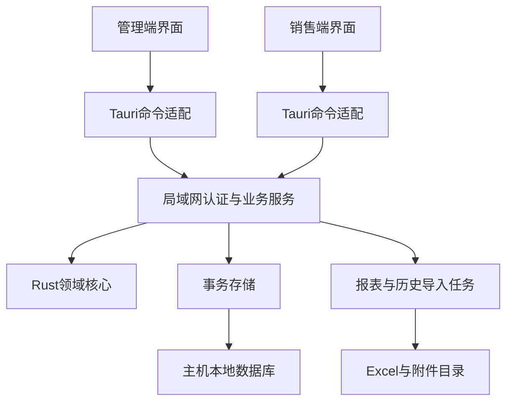

# Rust + Tauri 拟议架构与迁移方案

状态：完整Tauri拓扑仍为方案；Python过渡服务/账本已在P05交付，P06-01已创建独立Rust领域crate与影子核对入口，尚未接替生产服务或创建Tauri界面。约束入口为[主任务书](MASTER_PLAN.md)，业务字段和公式以[迁移契约](MIGRATION_CONTRACT.md)为准。

## 1. 为什么先优化数据与规则

现状中GUI控件既保存业务值又驱动I/O，两版复制规则且都可修改同一日工作簿；用户已在[P01-03登记](baseline/P01-03-data-deployment.md)确认目录同源、母版1～2台、销售数量未定及192.168.4.38长期在线。把语言替换成Rust仍会保留读改写竞争、订单身份冲突和隐藏成本泄露。先做必要Python改进是为了形成稳定的参考实现、数据样本和接口，不追求把旧Tkinter全面重写后再推倒。

## 2. 模块职责（拟议）

| 模块 | 负责 | 不负责 |
| --- | --- | --- |
| Web前端 feature目录 | 报价编辑、校验呈现、订单列表/详情、角色视图、任务进度 | 权威金额计算、直接SQL、任意文件写、信任本地role |
| Tauri命令适配 | IPC参数校验、会话与服务连接、受控文件选择、桌面生命周期 | 集中所有业务规则、把全部本机文件权限暴露给WebView |
| Rust领域核心 | 数值解析、价格快照、行序折扣、金额校验、订单状态 | UI、Tk、Excel单元格、HTTP框架 |
| 应用业务层 | 提交幂等、revision检查、角色授权、报表任务编排 | UI控件状态与未受控路径 |
| 存储/兼容适配 | 事务、schema迁移、Excel读写、历史导入、备份恢复 | 重新定义另一套销售/成本计算 |
| 局域网服务 | 认证、业务API、服务端过滤、持久化唯一写入口 | 客户端自由读写共享数据库 |

建议代码按 `crates/domain`、`crates/application`、`crates/storage`、`crates/legacy_excel`、`crates/server`、`src-tauri` 和前端功能目录组织；最终以真实依赖和职责决定是否单独crate，避免空壳层或每函数一文件。母子端共享领域实现和UI公共组件，通过授权视图区分，不复制两个完整工程。

## 3. 拓扑选择

首期多人路线为“客户端→服务→主机本地数据库”，优先采用用户登记的192.168.4.38常在线电脑；P05-02核实主机具体系统/服务身份/权限，服务尚未部署。母版1～2台、销售数量未定，实施前记录测试规模；单机适配仍需满足business-v1权限。可见目录设置、旧E盘路径仅显式导入、主机E盘根隐藏备份的分阶段要求见[目录/备份定义](baseline/P01-03-directory-backup.md)。

数据库由服务进程在主机本地访问。SQLite是当前规模的候选，不能放SMB路径让各客户端直接打开；是否需要其他数据库由并发与备份测试决定，不提前引入。SQLite官方区分应用服务访问和远端文件访问，后者存在网络锁与可靠性风险。[官方说明](https://www.sqlite.org/useovernet.html)

销售端如要求成本保密，数据必须在服务端过滤；客户端不接收成本价格、不持有含成本的共享工作簿访问权限。价格报价投影只有销售字段，提交时服务端按冻结版本计算成本。服务器端本地数据库的访问控制与备份权限同时覆盖敏感数据。隐藏按钮不能提供此保证。

## 4. Tauri边界

拟选Tauri 2大版本路线，具体版本在P06/P07建立锁文件时核验。前端框架未选择，按团队维护性及实测确定，不为展示引入额外状态框架或组件包。

- 使用命令/序列化DTO桥接Rust；耗时任务返回job_id并通知进度，避免在同步UI调用里遍历工作簿。[命令文档](https://v2.tauri.app/develop/calling-rust/)
- capabilities约束窗口/WebView可用的原生能力；仅开放必要命令与限定目录。自定义命令默认可调用的行为需显式审查，不能以“有capabilities文件”认定所有命令已受限。业务权限仍在服务端校验。[capabilities文档](https://v2.tauri.app/security/capabilities/)
- 设置CSP、禁用无需要的shell/任意SQL/远程页面原生权限，事件返回同样进行角色过滤。处理路径穿越、Windows junction/重解析点及相对路径越界；附件由服务生成受控标识。
- 选定Windows目标后核验MSVC工具链、WebView2、安装和更新方式；WebView2缺失/离线安装需要明确包策略，不能承诺Tauri打包后天然零依赖。[前置要求](https://v2.tauri.app/start/prerequisites/) / [Windows安装包](https://v2.tauri.app/distribute/windows-installer/)

## 5. Excel策略与技术验证

历史导入需要读取；新报表需要生成；原样编辑任意旧工作簿不是第一版必须支持的通用表格编辑器功能。先用真实脱敏工作簿验证读写候选库对中文、文本前导零、数字精度、样式、合并单元格、公式缓存、外链和大文件的支持，再选型。不能因某crate能生成xlsx就声称能无损修改历史文件。

如果Rust兼容暂时受阻，可评估隔离Python报表适配作为限时过渡，需明确协议、退出条件、打包体积、运行环境及失败行为，另在对应任务授权范围内决定；不默默永久保留双计算核心。优先采用结构化数据重新生成报表，旧原件只读备份。

Python数值改造优先标准库Decimal，并从原始文本构造；精度和舍入需显式指定。[Python Decimal](https://docs.python.org/3/library/decimal.html)。openpyxl只读模式采用流式迭代并显式关闭，审计已验证反复cell的性能问题；具体行为仍以选定版本验证。[优化模式文档](https://openpyxl.readthedocs.io/en/stable/optimized.html)

## 6. 共存与切换

1. P02–P04保留两版入口，统一规则及文件协议。所有写端同步升级；仍有旧版裸写时，不宣称共享并发已安全，限制为受控单写者。
2. P05引入服务和本地事务数据库，Python通过同一业务协议提交；Excel输出与账本分离。启用新账本前冻结旧共享写入口，禁止双权威写。
3. P06 Rust先对固定样本与脱敏副本做影子核对，影子路径只读或隔离写，不在真实账本双写；保持已确认schema/API兼容。
4. P07 Tauri逐功能接入同一服务，Python仍可作为已授权回退客户端；不能把本地编译通过当作迁移通过。
5. P08停写→备份哈希/恢复验证→dry-run→差异解决→事务导入→多维对账→只读核验→受控试用→验收切换。未知历史格式和同秒歧义先隔离，不能为了清零报告丢弃记录。

任何失败优先停止写入，保留源件与失败报告。已经产生新订单时，恢复旧版前先导出并核对迁移后的增量；schema不兼容则恢复到独立副本核验，不能强行降级原库。只保留一个有效写入入口。

## 7. 依赖决策记录要求

引入候选时记录用途、现有能力/替代方案、精确版本、许可证、传递依赖、Windows兼容、实际安装包增量及维护风险。当前没有完成这些库级评估，所以没有给出虚构体积或直接指定某个Rust Excel/金额/HTTP库。以上官方页面查阅日期为2026-10-10；实施时结合锁定版本复核。

## P03-03 可复用的过渡设置契约

[Python连接与价格契约](verification/P03-03-storage-contract.md)现已拆分本机连接777-local-v1、母版共享目录777-shared-v1与商品价格。P05/P06迁移显式来源与失败状态，Tauri用系统用户配置目录保存服务连接，保留目录字段的用途；不按安装盘符推导业务根。订单价格快照附表按订单/请求关联，在结构化存储中保留原版本，不用后续当前价格覆盖旧单。PNG请求、唯一目标和未知提交语义作为附件适配参考；服务数据库和隐藏独立备份仍按后续阶段实现。

[P04-03分页/附件契约](verification/P04-03-pagination-contract.md)已实现与Tk独立的完整视图/原行号筛选索引及冻结报价图投影，供后续Rust/Tauri迁移行为对照。页码不进入账本金额计算；PNG完整清单保留页范围/哈希/草稿revision，后续由服务绑定订单/附件身份。当前Windows应用HWND截图与数据生成的完整报价图是两个明确入口，屏幕像素不作为完整报价数据来源。

## P05-01已交付的结构化边界

[账本v1契约](verification/P05-01-ledger-contract.md)和[实际DDL](verification/P05-01-schema.sql)已交付Python标准库SQLite过渡实现；复用business-v1/numeric-v1，金额SQL整数分、JSON整数分字符串，高精度参数保留原文及规范值。schema指纹为SQLite元数据排序数组的紧凑UTF-8 JSON SHA256，Rust可复现；这不是Rust项目已创建或跨语言兼容已实测的证据。P05-02完成真实认证主体/传输/销售字段过滤/客户端切换，P06再接同一模型与黄金集。P04共享正式复验按用户授权延期，P05-01隔离开发先行；生产SQLite仍不得置于SMB。

## P05-02已实现的过渡服务边界

[HTTPS业务协议v1](verification/P05-02-service-contract.md)供Rust替代服务和Tauri调用复用；quote_core/ledger-v1不改。Rust接替时须匹配主体/会话撤销、字段允许列表、原请求幂等/未知提交、整单重算、版本CAS与只追加备注/作废恢复；API输入与金额字符串不转JS浮点。Python服务客户端通过显式入口接入原Tk布局，未自动切换生产或提前接Tauri。账户/TLS/计划与账本完整恢复的稳定ID、旧会话失效和维护门禁同属交接资产。当前42专项/427辅助仅为过渡实现证据，Windows和现场部署、03/04及P06/P07仍按阶段门槛执行。

P05-03交接补充：[导入契约](verification/P05-03-import-contract.md)提供legacy-import-v1适配、源哈希/预演SHA/归属绑定、原件字节及逐源行映射、原子批次与原请求核查。Rust接替须保留精确核心对账和未知/歧义隔离，不能把格式猜测、当前价格或客户字符串当作历史事实/账户；Source证据与销售DTO边界独立。当前本机管理CLI不等于Tauri导入页面已接入，页面与附件/报表在后续阶段交付。

### P05-04已实现的报表与查询适配

Rust保持ledger-v1、business-v1、numeric-v1与现有认证边界；接替[输出扩展DDL](verification/P05-04-output-schema.sql)、[777-output/query-v1样例](verification/P05-04-protocol.json)与[完整契约](verification/P05-04-output-contract.md)。报表从冻结的已提交订单生成，金融分按字符串传输，内部成本报表不能发布公共共享目录；持久任务回执/恢复与财务事务分离。备份v2包含任务和原缓存文件，v1兼容；签名view分页变化拒绝、审计增量统计的精确结果须一致。Tauri界面可替换现有服务账本/输出任务窗口，不重新实现计算或让前端直接改SQLite/Excel。

## P06-01已实现的Rust领域边界

`crates/quote-core`是当前Rust实现，复用同一53例黄金和Python修正版。`numbers`精确BigInt/scale；`calculation/models`顺序金额和冻结快照；`configuration`有界原始token JSON；`session`稳定draft_id/revision与输出门槛。独立`quote-shadow`只把验证DTO映射到领域核心。依赖中没有数据库/HTTP/Tauri/GUI，生产Python服务未切换；存储/API适配留P06-02，Excel留03，真实Windows服务影子与资源对比留04。

工具链固定1.97.1，直接依赖与全部15项传递包版本/许可/校验和见[P06依赖登记](verification/P06-01-dependencies.json)，锁文件与许可全文随源码保存。BigInt解决numeric-v1的1e45/60位中间容量，金额仍限制对称i64分；原JSON数字token不用f64解码。[Windows完整核对](verification/P06-01-windows-evidence-01.json)已确认32指纹/Rust21/Python58/561对照与原生MSVC release构建通过，01待用户验收；真实主机接替和安装包仍留对应后续任务。构建入口见[核心契约](verification/P06-01-core-contract.md)。

## P06-02已实现的原生账本/过渡服务适配

已新增`crates/quote-ledger`，依赖`quote-core`单向计算，并通过rusqlite内嵌SQLite复用ledger-v1；Python HTTPS/Auth保留为当前认证边界。`rust_ledger`私有进程桥接将金额计算与真实金融事务交给Rust，Python只读投影和内存格式预演，后端由离线维护配置选择。完整备份v3保存相同worker及许可，恢复仍维护。HTTP库整体验证/接替留P06-04，Rust Excel选型留03；当前不创建Tauri项目或双账本。

[02依赖登记](verification/P06-02-dependencies.json)固定全部48外部包及SQLite3.50.2公共领域源码指纹，根许可全文随源/主机包保存；原01依赖登记为当时领域crate快照，未修改历史报告。原辅助65专项/594完整与25 Rust/561对照保持；[第二轮Windows核对](verification/P06-02-windows-evidence-02.json)已通过83指纹/65专项/25 Rust/561对照及临时主机原生DPAPI/HTTPS/v3恢复/ACL，02已按[用户接续](verification/P06-02-acceptance.json)验收收尾。真实主机、GUI与安装包验收仍按后续任务执行。

## P06-03已实现的Excel适配

独立crates/quote-excel保留OOXML原始数字、类型/坐标/样式/纪元并生成新的777-output-v1四表文本报表；不编辑旧文件、不执行公式、不计算财务或发布路径。既有受校验worker的私有能力协商/字节操作接入导入内存计划及输出队列，全字段/样式独立读回，源原字节和v1批次绑定保持。见[03契约](verification/P06-03-excel-contract.md)及[检查证据](verification/P06-03-checks.json)。旧v3财务版worker格式能力为明确的python-v1-compatibility，原生财务写端不变；Python映射/日期及独立备份核对/PNG的桥接退出留04，未宣称已完成纯Rust宿主。
